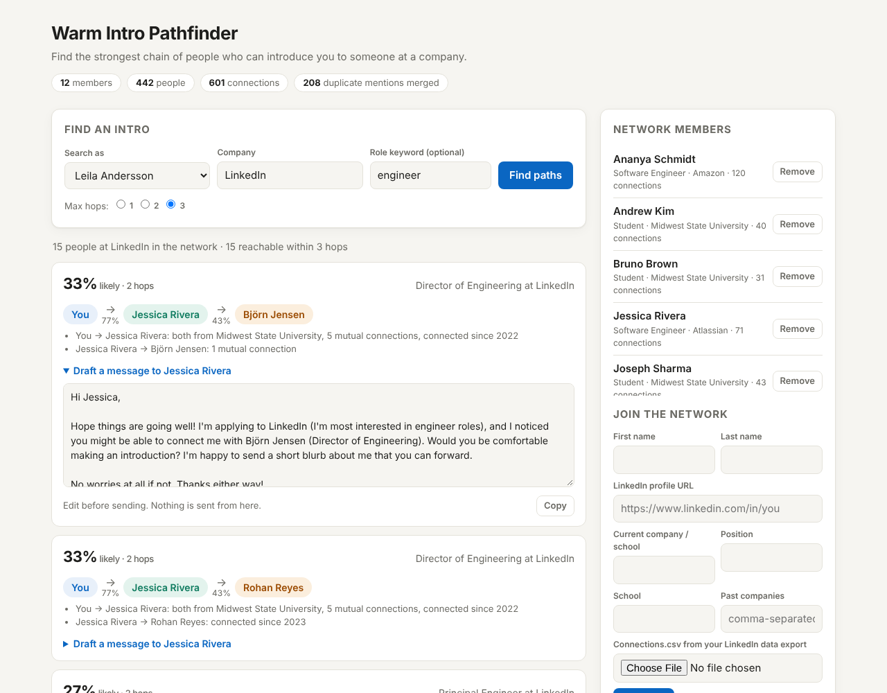

# Warm Intro Pathfinder

Find the strongest chain of people who can introduce you to someone at a company.

A group of people (a student club, a cohort, a group of friends) each upload the
`Connections.csv` from their own LinkedIn data export. Pathfinder merges those
files into one shared network, works out which rows are the same person, scores
how likely each person is to make an introduction, and finds the most promising
intro paths to anyone at a target company, with a drafted message for the first ask.



> **Why a group?** One person's export only lists *their own* connections, so it
> has no second-degree paths at all. Pooling opt-in exports is what creates
> multi-hop paths, and it's also what makes this an interesting engineering
> problem: the same person shows up in many files, spelled differently.

**Zero dependencies.** Plain Python 3.10+ standard library: no `pip install`, no API keys.

---

## Quick start

```bash
python -m pathfinder simulate              # write a fake 2,500-person network to data/demo
python -m pathfinder serve                 # open http://127.0.0.1:8000
```

From the terminal:

```bash
python -m pathfinder search                                   # lists member ids
python -m pathfinder search --member <id> --company LinkedIn --title engineer
python -m pathfinder eval                                     # score the person matcher
python -m pytest                                              # run the tests (needs pytest)
```

All demo data is simulated: every name is fictional. See [Simulated data](#simulated-data).

---

## How it works

```
uploads (profile + Connections.csv per member)
   │
   ▼  1. parse          tolerate real export quirks ("Notes:" preamble, blank rows)
   ▼  2. resolve        one node per real person (entity resolution)
   ▼  3. score ties     P(this person will pass the intro along)
   ▼  4. search         strongest path within K hops (hop-limited Dijkstra)
   ▼  5. present        rank, diversify, anonymize, draft the ask
```

### 1. Entity resolution: "is `Jon Smith, PhD` at *Facebook* the same as `Jonathan Smith` at *Meta Platforms, Inc.*?"

`pathfinder/normalize.py`, `pathfinder/matching.py`

- **Normalization:** strips accents, credentials (`PhD`, `MBA`), pronouns in name
  fields, and legal suffixes (`Inc.`, `LLC`, `& Co.`); maps aliases
  (`Facebook` → `meta`, `J.P. Morgan` → `jpmorgan chase`); canonicalizes profile URLs.
- **Pass 1, exact:** mentions with the same profile URL are merged (union-find).
- **Pass 2, fuzzy:** URL-less mentions are compared only within small *blocks*
  (same last name + same company), so the cost stays close to linear. They merge
  when first names are compatible: equal, a known nickname (`Bob`/`Robert`), or an initial.
- **Safety rules** (enforced inside the union-find, not as an afterthought):
  - *Cannot-link:* clusters with different profile URLs never merge, so two
    real "Alex Kim"s at the same company stay separate.
  - *No guessing:* a URL-less mention that could belong to two known people is left alone.
  - *No chaining:* unverified clusters must agree on every name, so `John` ~ `J.` ~ `Jane` can't collapse into one person.

### 2. Tie strength: how likely is this hop to work?

`pathfinder/network.py` (`WEIGHTS`)

A small logistic model with hand-set, explainable weights. Each signal that fires
also becomes a human-readable reason in the UI:

| Signal | Effect |
|---|---|
| Work at the same company now | ++ |
| One used to work at the other's company (from member profiles) | + |
| Both members from the same school | + |
| Mutual connections (log-scaled) | + |
| Connected 3+ years ago | + |
| Connected in the last 90 days | − |

With real feedback ("did the intro happen?") these weights could be fit with
logistic regression instead of set by hand.

### 3. Search: hop-limited Dijkstra

`pathfinder/search.py`

Edge cost = `−log(p)`. Adding costs along a path multiplies probabilities, so the
cheapest path is the *most likely to work*.

Plain Dijkstra isn't enough: intro chains longer than ~3 people rarely work, and
plain Dijkstra may pick a long chain of strong ties while a slightly weaker 2-hop
path exists. So the search runs over states `(person, hops_used)` and stops
expanding at K hops. One pruning rule keeps it fast: if a person was already
settled with fewer-or-equal hops, any later state for them is dominated
(higher cost *and* more hops) and is skipped.

Correctness is tested by comparing against brute-force enumeration of every
simple path on 40 random graphs × 4 hop limits.

### 4. Results, privacy and drafts

- Results are ranked by probability, and capped (max 25), so nobody can dump a member's list.
- **Diversified:** at most 3 results route through the same first person, so one
  well-connected friend doesn't get every request.
- **Privacy:** members never see each other's connection lists. Non-members
  deeper in a chain are shown only as *"a contact of Priya"*; only the person next
  to them knows who they are. Removing a member deletes their files and all their rows.
- **Draft message:** a template-based intro request to the first person in the
  chain. No LLM needed (an LLM rewrite would be an easy optional add-on).

---

## Simulated data

`pathfinder/simulate.py` generates a network that *behaves* like a real one, written
in exactly the format of a real LinkedIn export, so real uploads need no code changes.

- **Heavy-tailed degrees** (lognormal): a few hubs, most people with a few dozen connections.
- **Clustering:** people connect mostly with coworkers (past and present) and nearby graduating classes.
- **Careers:** people change jobs, so former teammates spread across companies.
- **Deliberate mess:** nicknames, initials, credentials, pronouns, lowercase,
  dropped accents, company spelling variants, missing URLs, and namesakes who
  share a name *and* an employer.
- **Ground truth:** the true identity of every row is saved, so matching can be scored exactly.

**Avoiding a rigged test:** the generator uses some nicknames the matcher
doesn't know (`Kit`, `Libby`, `Zeke`, `Mags`), and some rows have neither a URL
nor a company, so a perfect score isn't guaranteed.

### Results

Pairwise precision / recall of person matching, 5 random seeds (2,500-person world, 12 members):

| | Precision | Recall |
|---|---|---|
| URL-only baseline | 100% | 77% – 91% |
| **Pathfinder matcher** | **99.7% – 100%** | **96% – 100%** |

The rare errors are instructive: an initial like `T. Jensen` at Amazon gets merged
with the only *known* T. Jensen there, even when it's actually a different person.
Initial matching trades a little precision for a lot of recall.

**Caveat:** these numbers are on simulated data designed by the same person who
wrote the matcher. They prove the algorithm does what it claims on realistic
mess; they are not a claim about real-world accuracy.

---

## Project structure

```
pathfinder/
  normalize.py   names, companies, URLs -> canonical keys
  loader.py      parse real Connections.csv exports, member profiles
  matching.py    entity resolution: constrained union-find + blocking
  search.py      hop-limited Dijkstra (+ brute-force reference for tests)
  network.py     builds the graph, tie strength, ranking, privacy, drafts
  simulate.py    realistic fake network + ground truth
  evaluate.py    precision/recall vs a URL-only baseline
  server.py      JSON API + web page (stdlib http.server)
  static/        the web UI
tests/           95 tests: normalization, parsing, encodings, matching, search, API
```

## Ideas for next steps

- Learn tie-strength weights from intro outcomes (logistic regression).
- Company-name normalization from a larger alias list, or embedding similarity.
- Accounts and per-member visibility controls; SQLite instead of files.
- Optional LLM rewrite of the drafted message, with the template as fallback.
- Graph visualization of the shared network.
